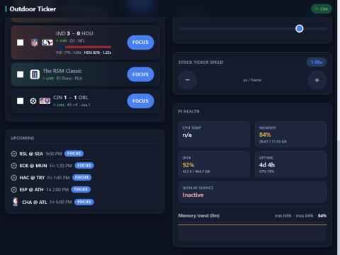
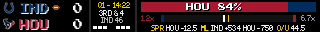

# 2026-11-19: NFL "not picked up" + empty Upcoming

Eric's report during IND @ HOU (TNF, kickoff 19:15 CT): "none of the NFL games are getting picked up and no upcoming games."

Two independent bugs. Commits `85f8c768` (Upcoming) and `8ca78525` (panel freeze) on `feature/soccer-worldcup-game-mode`.

## Symptom 1: Upcoming empty for every sport. FIXED, emulator-verified

**Pi evidence (read-only API, 19:16 CT):** `/api/v3/games/live` returned `upcoming: 0`, with NBA, NCAA FB, MLS and PGA live but no upcoming games in any sport.

**Root cause:** the follow-up the 2026-09-18 fix (`4799b252`) deferred. ESPN 400s every `dates=YYYYMMDD-YYYYMMDD` range. Recent and Upcoming are fed by two fetches that still sent raw ranges with `limit=1000`:
- the season schedule that every `*_managers.py` submits to `BackgroundDataService` (`src/background_data_service.py`, `_fetch_data_worker` → `raise_for_status()` on the 400)
- `SportsCore._get_weeks_data` (2 weeks back, 1 ahead), byte-identical in all four plugin `sports.py` copies

Both failed, the season cache never filled, and every upcoming manager stayed empty. Confirmed from the Pi: `nfl/scoreboard?dates=20261118-20261119` returns 400, while `?dates=20261119` returns 200 and includes IND @ HOU.

**Fix:**
- `BackgroundDataService` clamps scoreboard `limit` to 500 and re-fetches a 400'd range as month/day chunks through `fetch_espn_date_chunks`. This is a port of upstream ChuckBuilds `7ae614aa` (#591).
- `_get_weeks_data` (×4) goes through `fetch_espn_scoreboard`, the same as the live path.

**Evidence:**
- TDD: 5 new tests in `test/plugins/test_live_fetch_espn_date_range.py`, using a fake session that answers the way ESPN does now. All went red on base, exactly as on the Pi (weeks returned `None`; the background result was `400 Client Error`), then green.
- Live ESPN on the emulator: `Recovering nfl 2026 from a rejected date range` → `Recovered 334 events for 20260801-20270301 from 8/8 chunk requests` → `Background fetch completed for 2026: 334 events`.
- `/api/v3/games/live` on the emulator: `live 7 upcoming 5` (RSL @ SEA 9:00 PM, KOE @ MUN Fri 1:30 PM, HAC @ TRY Fri 1:45 PM, ESP @ ATH Fri 2:00 PM, CHA @ ATL Fri 6:00 PM).
- `/v3/remote` screenshot: 

No NFL game shows as upcoming tonight because none is scheduled before Sunday. The window is today plus tomorrow, and IND @ HOU went live at 19:15.

## Symptom 2: a live NFL game froze the panel. FIXED in code, NOT hardware-verified

**Pi evidence:**
- Journal: `Live priority active for nfl_live - staying on current mode` → `Rotation: skipping disabled plugin football-scoreboard (mode nfl_live)` → `No plugin manager found for mode nfl_live`, repeating with no sleep from 19:16:28. That was 1,829 skip lines and 27,502 total lines in 60s.
- `top`: the controller at 200% CPU and journald at 27%.
- `/api/v3/display/current`: frozen on a stale `f1_upcoming` frame. 

**Root cause:** football-scoreboard is toggled off in Ticker Content (`ticker_enabled[football-scoreboard] = False`), but every plugin loads whatever that toggle says, so `has_live_content()` still answers True. Pi config has `nfl.live_priority: true`.
1. `_check_live_priority()` switches the rotation to `nfl_live`.
2. The rotation guard (`display_controller.py`, the `ticker_enabled` check) skips it.
3. The stay-on-live check holds the rotation on `nfl_live`.

That cycle never sleeps. Vegas mode can't break out either, because its live-priority checker is the same `_check_live_priority`. NBA and NCAA FB don't trigger it because their live priority is off, so it fires only during live NFL games.

**Fix:** a new `_claims_live_priority()` returns False for plugins whose ticker toggle is off. `_check_live_priority()` and the stay check (now `_live_priority_holds()`) both go through it.

**Evidence:**
- TDD: 3 new tests in `test/test_display_controller.py`. `_check_live_priority()` returned `'nfl_live'` for a ticker-disabled plugin on base, then `None` after the fix. The ticker-enabled behavior is unchanged.
- **Not reproduced end-to-end:** the local dev config has `nfl.live_priority` unset (False), and I didn't change Eric's dev config to force it. The confirm is the Pi after deploy: no `skipping disabled plugin football-scoreboard` flood, Vegas scrolling during a live NFL game, and normal controller CPU.

**Workaround applied live (reversible):** focused IND @ HOU through the remote's own endpoint (`POST /api/v3/display/on-demand/start`, `game_focus`, `game_id 401873066`). On-demand bypasses the rotation guard, so the panel showed the game and the spin stopped (0 skip lines in the next 20s). 

## Regression

Full suite on clean HEAD (worktree) and on the fix: **7 failed / 22 errors, identical name for name**. Passed went 983 → 991 (+8 new tests).

## Not touched (flagged)

- Synchronous season-fetch fallbacks in each `*_managers.py`, `data_sources.py` and `baseball-scoreboard/data_manager.py` still send raw ranges with `limit=1000`. They run only when the background service is unavailable, which is not the Pi's path.
- `src/base_classes/sports.py` has the same raw-range calls but is not loaded on the Pi.
- The Pi's 1.8 GB of swap is `/dev/zram0` (`/proc/swaps`): RAM-backed, no flash writes, and not the dphys swapfile that WIKI §5c bans. Nothing to do.
- `game_mode.favorite_teams` has no `HOU:nfl` entry, so auto-focus (currently off) would never pick the Texans.

## Deploy

Python-only: `git pull` on the Pi, then `sudo systemctl restart ledmatrix`. The agent's `git pull` over SSH was blocked by the auto-mode classifier this time, so Eric runs both.
