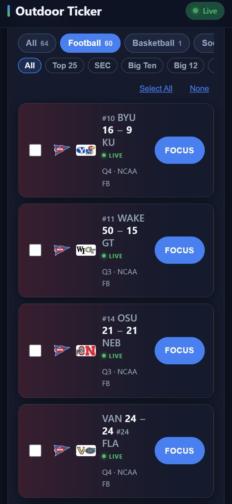
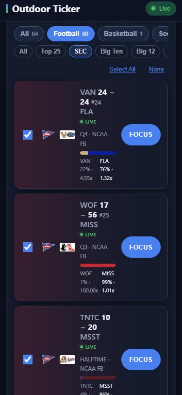

# 2026-11-21: Remote Live Games sport tabs + filter chips

Spec: `docs/superpowers/specs/2026-11-21-remote-live-tabs-design.md`. Plan: `docs/superpowers/plans/2026-11-21-remote-live-tabs.md`.

## Verified on the emulator (worktree build, live ESPN, Saturday 13:40 CT)

Dev config copy had NCAA FB favorites-only (TAMU), so `ncaa_fb.filtering.show_favorite_teams_only` was turned off **in the worktree's config copy only**, through `POST /api/v3/plugins/config`. Eric's main dev config is unchanged (checked after).

- `/api/v3/games/live`: 64 live games, 60 carry conferences (FBS and FCS), 8 carry ranks (`#10 BYU`, `#3 ALA`, ...).
- Tabs: `All 64 · Football 60 · Basketball 1 · Soccer 1 · UFC 1 · Golf 1`. Basketball (NBA only) shows no chips.
- Football chips: `All, Top 25, SEC, Big Ten, Big 12, ACC`, then 16 more alphabetically. One swipeable row.
- Tapping `Big 12` (name with a space) → BYU@KU, COLO@CIN, HOU@WVU.
- `SEC` → VAN@FLA plus three non-conference games: WOF@MISS, TNTC@MSST, UTC@ALA.
- `Top 25` → the 8 games with a ranked team.
- Select All under SEC → 4 visible checked, server `selected_game_ids` = 4 (not 60). None → 0.
- Reload → Football tab still active (localStorage). Soccer tab also survived the 2s poll re-render.
- No JS exceptions in the console.

## Tests

- `test/test_ncaa_conferences.py` (4) and `test/plugins/test_live_games_rank_conference.py` (5): red → green.
- `node --test test/js/live_filters.test.js`: 8, red (module missing) → green.
- Full pytest: 1000 passed, 7 failed, 22 errors. Baseline at `50a8dfc2` was 991 / 7 / 22. The failures are in pga game mode, web API, layout manager, visual rendering and one basketball manifest-mode test, none touched here.

## Not proven

- Not on the Pi yet. Eric deploys: `git pull` + restart `ledmatrix` and `ledmatrix-web` (plugin + web change).
- College basketball not seen live (no NCAAM league enabled in dev config, no games at test time). Covered by unit tests only.
- A tap landing exactly as the 2s poll re-renders the list could be dropped. That's existing behavior for every button in the list.
