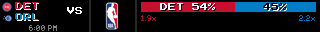
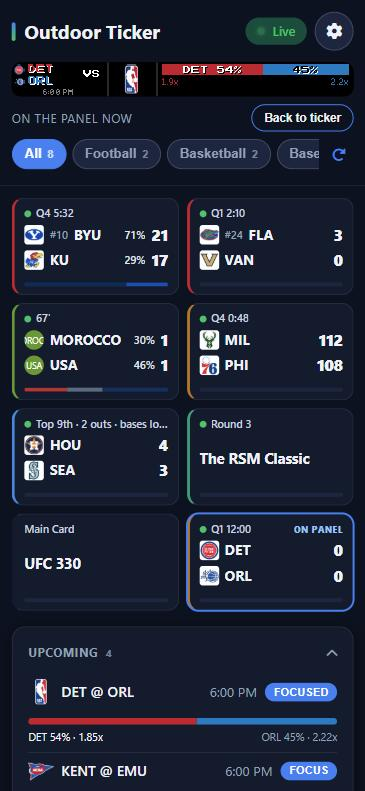
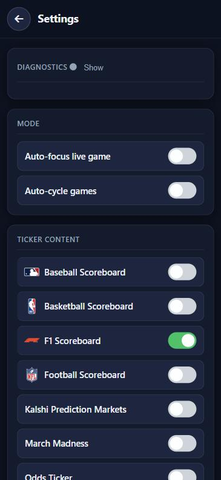
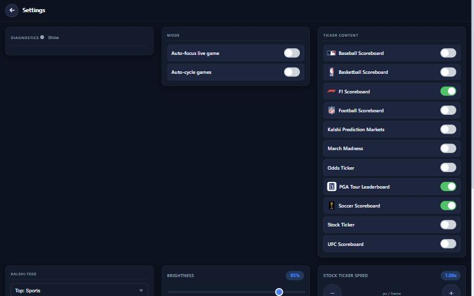
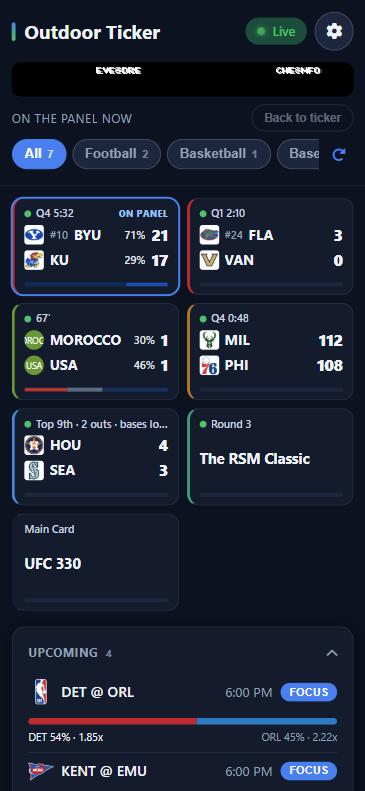
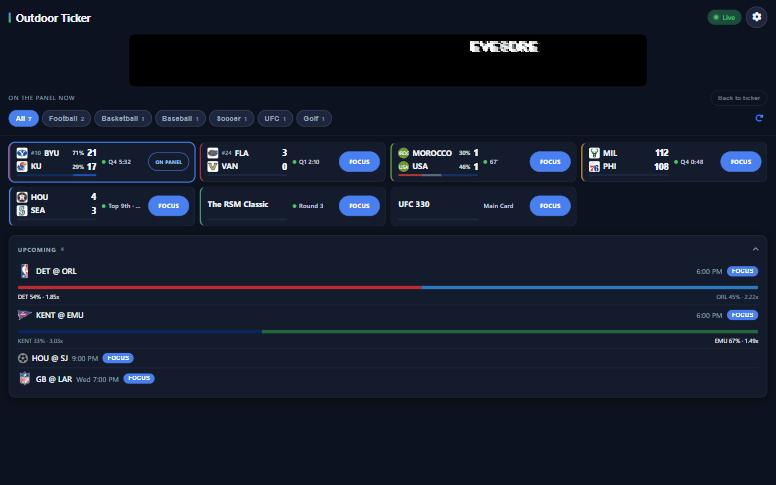
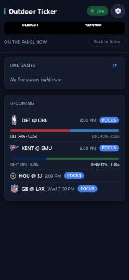

# 2026-11-24: Remote live-first layout

Spec: `docs/superpowers/specs/2026-11-21-remote-live-first-design.md`. Plan: `docs/superpowers/plans/2026-11-22-remote-live-first.md`. Branch `feature/remote-live-first`, commits `addbb39e..9d9e900c`.

Tested on the emulator from the worktree (`emulator-tabs` + `webui-tabs`), Tuesday afternoon CT. Nothing was live at test time, so list layout was measured with a fixture (`assets/2026-11-22-remote-live-first/live-mixed.json`) served by a page-side `fetch` shim on `/api/v3/games/live`. The shim replaced only `data.games` (and, for the layout runs, `focused_game_id`). Everything else came from the real server. For the tap tests the shim added one card carrying the real id of tonight's DET@ORL game (`401909314`, `basketball-scoreboard`), so a tap drove a real focus.

## 1. Nothing moves when you filter. PASS

Fixture: #10 BYU @ KU (two-way Kalshi), #24 FLA @ VAN (no Kalshi), MOROCCO @ USA (three-way), MIL 112 @ PHI 108, MLB with `Top 9th · 2 outs · bases loaded`, golf `The RSM Classic · Round 3`, UFC `UFC 330 · Main Card` (`UFC TONIGHT`, pre).

| Check | 375×812 | 1440×900 |
|---|---|---|
| Tab row `top` across All → Football → Basketball → Football/SEC → All | 143.1 every step | 204 every step |
| `#live-games` left edge across the same switches | 12 | 16 every step |
| Card heights in the mixed list | all 100px (2 × 171.5px columns) | all 74px (4 × 346px columns) |
| Chip row on Football (4 chips) / Basketball (no college, 0 chips) | 33 / 33 | 33 / 33 |
| Horizontal overflow | 0 | 0 |

The list's own top differs between chip tabs (236/297) and other tabs (203/264). The spec allows that, because switching tabs is a tap that replaces the list anyway.

## 2. Nothing moves across polls. PASS

Each row is `[tab row top, first card top, card heights, odds segments, chip row height]`.

- **Odds arrive.** The fixture was served without `kalshi`, then with it, on the All tab.
  - 375: `143.1, 203.1, 100, 0 segs` → `143.1, 203.1, 100, 5 segs`
  - 1440: `204, 264, 74, 0` → `204, 264, 74, 5`
- **College game goes live on a chip tab.** The Basketball tab was served NBA only, then NBA plus `#3 DUKE @ #12 UNC` (ncaam, ACC).
  - 375: the chip row went from 0 chips to `All|NBA|Top 25|ACC`, with its height 33 → 33 and the first card top 236.1 → 236.1.
  - 1440: the first card top stayed 297 → 297.

## 3. Tap to focus, ON PANEL, Back to ticker. PASS

All on the emulator, against the real DET@ORL game.

- **Desktop card tap (1440).**
  - ON PANEL was on the card immediately, and Back to ticker enabled immediately.
  - ON PANEL held for 16 of 16 seconds with no flicker.
  - The server's `focused_game_id` became `401909314` at 9.9s. That is the ~12s lag the 15s hold covers.
  - The panel picture changed 2.0s after the tap.
  - On-demand status was `active basketball-scoreboard game_focus`.
  - Panel PNG: 
- **Back to ticker.**
  - ON PANEL cleared immediately and stayed at 0 for 17s. The button stayed disabled for 17 of 17 seconds.
  - Server status was `idle`, and the server's `focused_game_id` cleared at 10.2s.
  - Panel PNG: 
- **Phone tile tap (375).**
  - The FOCUS label is hidden on tiles; the whole tile is the button.
  - The ON PANEL tag showed on the tile, Upcoming's DET@ORL row read FOCUSED, and the panel picture showed the game.
  - Panel PNG: 
  - Screenshot: 
- **Flicker found and fixed during the build.**
  - With Task 3's original 3s mode lock, Back to ticker re-enabled about 5s after the tap and then went off again (samples `0111`).
  - The cause: the lock expired before the server's reads caught up. Those reads are browser-cached for 5s, plus the 5s publish throttle and the 2s web memory cache.
  - The lock now uses the same hold as ON PANEL (`remote.js:215` `refreshMode`, `:273` `_setModeUIOptimistic`).
- **Upcoming FOCUS still works.** It read FOCUSED and was disabled at 1.5s, and the server's `focused_game_id` was `401909314`.

## 4. Panel picture. PASS

At 375:

- `img.src` changed at +1.0s, +7.1s and +14.1s over 16s. That's the 2s poll, mostly answered from the 5s browser cache, as designed.
- The box measured 351×35 with a frame and with the image hidden (no frame yet), so nothing shifts when the first frame lands.
- **Null frame.** A shim answered `/display/current` with `image: null` 3 times. `src` was unchanged and the picture stayed shown.
- **`no-store` use.** Over the 8 regular poll calls there were 0 `no-store` requests. One `focusGame` caused exactly 1, and one `backToTicker` caused exactly 1.

## 5. Settings view. PASS

- The gear opens Settings in this order: Diagnostics, Mode, Ticker Content, Kalshi Feed, Brightness, Speed, Pi Health. Back returns to the live view, scrolled to the top.
- The Mode section is just the two switches.
- **Brightness.** The pill followed the slider 85 → 50 → 85. Only the input event was sent, nothing was committed.
- **Ticker toggle.** A tap staged a change (pending bar shown, count 1), and Discard reverted it (count 0).
- Pi Health showed memory `82%…`.
- At ≥1024 the Settings sections lay out in 3 grid columns. The live view has no `column-count` anywhere.
- Screenshots:  

## 6. Upcoming collapsed. PASS

- With the stored key cleared, the page loaded collapsed (`aria-expanded=false`). The count showed `4`, matching the API (`upcoming` 4 + `upcoming_more` 0). The section is 53px tall.
- Opening it stored `'1'` and it was still open after a reload. Closing it stored `'0'` and it was still collapsed after a reload.

## 7. Leftover selection is cleared once. PASS

- Setup: `POST /api/v3/games/select {"selected_game_ids":["stale-1"]}`, and the server echoed `["stale-1"]`. Then I reloaded `/v3/remote`.
- `/games/live` with `no-store` at 2s, 7s, 12s and 17s returned `[]` every time.
- Exactly one `/games/select` request was made during that page load.
- The known controller race (it republishes its own copy of the selection) did not bring the stale id back.

## 8. Console. PASS

On a fresh `/v3/remote` load with 4+ polls, there were no new console errors and no responses ≥400. The 7 errors in the tab's log are from the desktop `/v3/` page that the preview opened at server start: the dormant `/v3/partials/games` 404 and its vegas JSON parse error.

## Screenshots

- Live view at 375 with the fixture and BYU on the panel: 
- Live view at 1440 with the fixture: 
- Live view at 375 with real data and no live games, from Task 4: 

## Tests

- **pytest, new:** 5 in `test/test_display_controller.py` and 3 in `test/web/test_games_live_focus_api.py`. 5 in `test/test_web_api.py` (settings view, gear/no mode buttons, panel picture, pinned tabs, Upcoming collapsed). Each was red, then green.
- **node:** `node --test test/js/*.test.js` → 31 pass.
  - `live_cards.test.js` has 22 tests, and the chip-slot test was added. All were red (module missing / `hasChipSlot is not a function`), then green.
  - The 4 Select All / None tests were deleted along with the functions.
  - The plan's `node --test test/js/` errors on this node version, so a glob was used.
- **Full pytest:** 1027 passed, 8 failed, 22 errors. The baseline at `a93c4fa0` was 1015 / 7 / 22, and every baseline failure is unchanged.
  - The one new failure was `test_config_flows.py::test_multiple_config_changes`. It is a timing flake: `src/config_manager_atomic.py:306` names backups to the second, so two saves in the same second share a backup file.
  - It passed 5 of 5 times when run alone. This branch doesn't touch that code.

## Code

- **Controller:** `src/display_controller.py:1522` `_panel_game_id`, published at `:1570`. `web_interface/blueprints/api_v3.py:1845,1888` passes it through.
- **Pure logic:** `web_interface/static/v3/js/live_cards.js`.
- **`remote.js`:**
  - Panel picture at `:173`, `:184`.
  - Mode hold and Back to ticker at `:215`, `:245`, `:273`, `:321`.
  - Panel hold and one-time selection clear at `:400`, `:421`.
  - List at `:553`, `:600`, `:629`.
  - Upcoming at `:464`.
- **CSS:** `app.css:1713` (live-first block), cards at `:1783`, tiles at `:1843`.

## Reproduce

1. Start the worktree's `emulator-tabs` and `webui-tabs`, then open `http://localhost:5000/v3/remote`.
2. To test layout without live games, wrap `window.fetch` so that `/api/v3/games/live` responses get `data.games` replaced by `live-mixed.json`'s games. The commands used are in this session's transcript. The shim is debug-only and not committed.

## Not proven

- **Not on the Pi.** Task 1 is Python, so Eric deploys with `git pull`, then restarts both `ledmatrix` and `ledmatrix-web`. Restarting only the web service leaves the old controller running, which publishes no `focused_game_id`. In that case nothing shows ON PANEL until the hold, and the page shows no errors.
- **No real live games during the test.**
  - Card layout and the stability numbers come from the fixture.
  - The focus/ON PANEL/Back to ticker runs used a real pre-game NBA game, shown as live by the shim.
  - Golf ON PANEL while golf is focused (no `game_id`) is covered only by the node test `golf is on the panel whenever golf mode is active`.
- **The `fix/game-selection-race` branch** (uncommitted, its own worktree) was not merged or tested together with this. Its client-side checkbox code is dead after this branch, so don't ship it as-is.
- **Team badges without a logo URL** (MOROCCO in the fixture) clip the abbreviation inside the 20px circle. Real World Cup teams carry logo URLs. The badge fallback is existing code.
